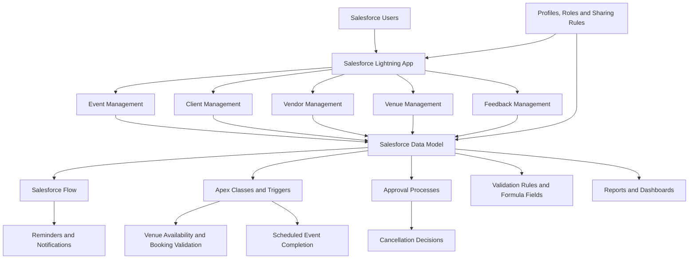

# 🎉 EventForce Management System — Salesforce Implementation

**A Smart, Automated Event Management CRM Built on Salesforce**

Streamlining event bookings, venue reservations, vendor coordination, client communication, and business analytics through Salesforce automation and customization.

---

## 📌 Table of Contents

- [Overview](#-overview)
- [Problem Statement](#-problem-statement)
- [Project Objectives](#-project-objectives)
- [Key Features](#-key-features)
- [Salesforce Data Model](#-salesforce-data-model)
- [Technology Stack](#-technology-stack)
- [System Architecture](#-system-architecture)
- [Automation and Business Logic](#-automation-and-business-logic)
- [User Interface and Analytics](#-user-interface-and-analytics)
- [Security and Access Control](#-security-and-access-control)
- [Data Migration and Testing](#-data-migration-and-testing)
- [Project Documentation](#-project-documentation)
- [Project Demo](#-project-demo)
- [Implementation Phases](#-implementation-phases)
- [Business Benefits](#-business-benefits)
- [Challenges and Learning Outcomes](#-challenges-and-learning-outcomes)
- [Deployment](#-deployment)
- [Future Enhancements](#-future-enhancements)
- [Conclusion](#-conclusion)
- [Author](#-author)

---

## 🚀 Overview

The **EventForce Management System** is a Salesforce-based Customer Relationship Management (CRM) solution designed to simplify and automate event-planning operations.

Managing an event involves coordinating clients, event schedules, venues, vendors, budgets, cancellations, and customer feedback. Handling these activities manually can lead to scheduling conflicts, communication delays, duplicate bookings, and inefficient record management.

EventForce brings these operations together in a centralized Salesforce environment. It uses custom objects, relationships, Salesforce Flow, Apex classes and triggers, approval processes, validation rules, reports, dashboards, and role-based security to improve the management of event-related activities.

The system was implemented in a Salesforce Developer Edition organization as a practical demonstration of CRM customization, workflow automation, data modeling, access management, and reporting.

### 🎯 Project at a Glance

| Attribute | Details |
|---|---|
| Project Name | EventForce Management System |
| Project Type | Salesforce CRM Implementation |
| Domain | Event Management |
| Platform | Salesforce Lightning |
| Business Focus | Event planning and coordination |
| Core Technologies | Salesforce Objects, Flow, Apex, Approval Processes |
| Analytics | Salesforce Reports and Dashboards |
| Security | Profiles, Roles, Permission Sets, Sharing Rules, OWD |
| Documentation | Implementation PDF and project demonstration video |
| Environment | Salesforce Developer Edition |

---

## ❗ Problem Statement

Traditional event management involves multiple interconnected activities that require accurate coordination and timely communication.

Common challenges include:

- Maintaining separate records for clients, events, vendors, and venues.
- Tracking event dates, budgets, and booking statuses manually.
- Preventing multiple events from being scheduled at the same venue on the same date.
- Sending event reminders and cancellation notifications on time.
- Managing cancellation requests and approval decisions.
- Maintaining accurate records and controlling access to sensitive information.
- Monitoring upcoming events and reviewing operational performance.

**Proposed solution:** Implement a centralized Salesforce CRM system that organizes event-related information, automates important business workflows, enforces data validation, and provides operational visibility through reports and dashboards.

---

## 🎯 Project Objectives

The main objectives of EventForce are to:

1. Centralize event, client, vendor, venue, and feedback information.
2. Create meaningful relationships between event management records.
3. Automate event reminders and cancellation approval workflows.
4. Calculate event budgets using formula fields.
5. Prevent venue double-booking conflicts using Apex triggers.
6. Update venue availability according to event status.
7. Apply validation rules to improve data accuracy.
8. Configure user access according to organizational responsibilities.
9. Provide reports and dashboards for monitoring event operations.
10. Establish a documented implementation structure that can support future deployment.

The original project document identifies reducing manual processes by 60% and improving booking efficiency by 40% as business objectives. These are **target improvements, not independently measured results**.

---

## ✨ Key Features

### 1. Centralized Event Management

Create and manage event records with relevant information, including:

- Event name
- Event date
- Event type
- Event status
- Event budget
- Associated client
- Reserved venue

Supported event types include weddings, corporate events, birthdays, anniversaries, festivals, concerts, and other events.

Event statuses include Planned, Confirmed, Completed, Pending Cancellation, Canceled, and Rejected.

### 2. Client Management

Maintain client information in one place, including names, email addresses, phone numbers, addresses, countries, and cities.

Client records can be associated with their events and feedback, supporting better communication and relationship management.

### 3. Vendor Management

Maintain vendor information and service categories, including:

- Catering
- Decoration
- Photography
- Videography
- Lighting
- Stage setup
- Makeup services
- DJ and music
- Transportation
- Hosting and anchoring

Vendor status tracking supports coordination of service providers.

### 4. Venue Management

Store venue addresses, location URLs, capacity, and availability status.

Venue availability is updated using Apex business logic when an event becomes confirmed or canceled.

### 5. Event–Vendor Coordination

A junction object establishes a many-to-many relationship between events and vendors.

This allows an event to be associated with multiple vendors and a vendor to be associated with multiple events.

### 6. Client Feedback Management

Collect client ratings and comments for completed or managed events.

Feedback records are connected to clients and events, helping organize customer responses and support service improvement.

### 7. Automated Event Reminders

A scheduled path in Salesforce Flow is configured to send a reminder email **three days before a confirmed event**.

The email can include event details and venue information, helping clients prepare for upcoming events.

### 8. Cancellation Approval Workflow

An approval process manages event cancellation requests.

The workflow includes:

- Submission of cancellation requests.
- Assignment to an approver.
- Email notifications.
- Final approval and rejection actions.
- Event status updates based on the configured outcome.

### 9. Automated Venue Availability

Apex logic updates venue availability according to the associated event status.

- Confirmed event → Venue marked as Reserved.
- Canceled event → Venue marked as Available.

### 10. Double-Booking Prevention

An Apex trigger checks existing event records for venue and date conflicts.

When a conflicting booking is detected, the record is prevented from being saved with a validation error.

### 11. Automated Event Completion

Batch Apex and Scheduled Apex are configured to process past events and update their statuses to Completed.

This reduces the need for manual status updates.

### 12. Reports and Dashboards

Salesforce reports and dashboards provide a centralized view of upcoming events, monthly event summaries, event budgets, and operational information.

### 13. Role-Based Access Control

Profiles, roles, permission sets, organization-wide defaults, and sharing rules help control access to event records and related information.

---

## 🗂️ Salesforce Data Model

The application uses six custom objects to organize its business data.

| Custom Object | API Name | Purpose |
|---|---|---|
| Event | `Event__c` | Stores event details, dates, status, budget, client, and venue |
| Client | `Client__c` | Stores customer contact information |
| Vendor | `Vendor__c` | Stores vendor details and service categories |
| Venue | `Venue__c` | Stores venue location, capacity, and availability |
| Feedback | `Feedback__c` | Stores ratings and customer comments |
| Event Vendor | `EventVendor__c` | Connects events and vendors through a junction object |

### Object Relationships

| Relationship | Type |
|---|---|
| Event → Client | Lookup |
| Event → Venue | Lookup |
| Feedback → Event | Lookup |
| Feedback → Client | Lookup |
| Event Vendor → Event | Master-Detail |
| Event Vendor → Vendor | Master-Detail |

The Event Vendor junction object implements the many-to-many relationship between events and vendors.

These relationships support record navigation, related lists, data organization, and reporting.

---

## 🛠️ Technology Stack

| Technology | Purpose |
|---|---|
| Salesforce CRM | Core application platform |
| Salesforce Lightning | User interface and application navigation |
| Custom Objects and Fields | Business data storage |
| Lookup Relationships | Connecting related business records |
| Master-Detail Relationships | Implementing junction-object relationships |
| Salesforce Flow | Declarative workflow automation |
| Apex | Custom business logic |
| Apex Triggers | Record-level validation and event-driven processing |
| Batch Apex | Processing collections of event records |
| Scheduled Apex | Scheduling recurring background processing |
| Approval Processes | Managing cancellation approvals |
| Validation Rules | Enforcing data-entry rules |
| Formula Fields | Calculating event budgets |
| Email Templates and Alerts | Automated communication |
| Profiles and Permission Sets | Managing permissions |
| Roles and Sharing Rules | Controlling record visibility |
| Salesforce Reports | Summarizing operational data |
| Salesforce Dashboards | Visualizing business metrics |
| Data Import Wizard | Importing prepared business records |

---

## 🏗️ System Architecture

The following diagram illustrates the logical structure of the EventForce implementation.

### Architecture Explanation

1. **Presentation layer:** Salesforce Lightning provides the application interface and navigation.
2. **Data layer:** Custom objects and relationships store business records.
3. **Automation layer:** Salesforce Flow and approval processes handle recurring workflows and decisions.
4. **Logic layer:** Apex classes and triggers enforce additional business rules.
5. **Security layer:** Profiles, roles, permissions, and sharing settings control access.
6. **Analytics layer:** Reports and dashboards summarize operational information.

---

## ⚙️ Automation and Business Logic

### A. Event Budget Formula

The Event Budget field is a formula field with a Currency return type.

The configured budget values are based on event type:

| Event Type | Configured Budget |
|---|---:|
| Wedding | ₹50,000 |
| Corporate | ₹30,000 |
| Birthday | ₹10,000 |
| Anniversary | ₹20,000 |
| Festival | ₹60,000 |
| Concert | ₹40,000 |
| Other | ₹15,000 |

The formula calculates the configured budget automatically from the selected event type.

### B. Three-Day Reminder Flow

**Flow:** `Client Reminder - 3 Days Before`

Configured workflow:

1. Trigger when an event is created or updated.
2. Check that the event status is Confirmed.
3. Use the event date as the time source.
4. Configure a scheduled path three days before the event.
5. Prepare the email subject and body using text templates.
6. Send the reminder to the client's email address and copy the event owner, as configured.

This workflow supports timely client communication.

### C. Event Cancellation Approval

**Approval Process:** `Event_Cancellation_Process`

The configured entry criteria identify events whose status is Pending Cancellation.

The process includes an approver assignment, an approval request notification, final approval actions, and rejection actions.

| Outcome | Configured Action |
|---|---|
| Approved | Update event status to Canceled and send an owner notification |
| Rejected | Update event status to Rejected and send an owner notification |

Email templates are configured for the cancellation request, approval notification, rejection notification, and client cancellation notice.

### D. Venue Status Automation

**Apex class:** `VenueStatusHelper`

**Trigger:** `EventTrigger13`

The helper class processes event records and updates the related venue status based on the event status.

### E. Double-Booking Prevention

**Trigger:** `PreventDoubleBooking`

The trigger checks whether an existing event uses the same venue on the same date. If a conflict is found, it adds an error to the event record to prevent the conflicting save.

### F. Batch and Scheduled Processing

**Batch class:** `BatchCompleteEvents`

**Scheduled class:** `ScheduleCompleteEvents`

The batch process selects past events that are not already Completed and updates their statuses. Scheduled Apex initiates the batch job according to its configured schedule.

These components demonstrate asynchronous processing and recurring business automation in Salesforce.

---

## 📊 User Interface and Analytics

### Custom Lightning Application

A custom Lightning application, **Event Planner**, brings the primary modules into one workspace.

The configured navigation includes:

- Events
- Clients
- Vendors
- Venues
- Feedback
- Reports
- Dashboards

This provides a centralized interface for managing event operations.

### Reports

The project includes an **Upcoming Events by Month** report.

The report is configured to support:

- Viewing upcoming event records.
- Grouping events by calendar month.
- Summarizing event counts.
- Calculating total event budgets.
- Displaying event names, dates, types, clients, and venues.
- Visualizing results through a column or line chart.

### Dashboard

The **EventForce Operations Dashboard** uses a report-based widget to present an overview of upcoming events.

These analytics capabilities help users monitor schedules and understand event activity without manually reviewing every record.

---

## 🔐 Security and Access Control

The implementation includes Salesforce security configurations designed to separate responsibilities across different user groups.

### Configured User Profiles

- Event Admin
- Event Coordinator
- Vendor Manager
- Client Profile

### Security Components

**Profiles:** Define object permissions, tab visibility, application settings, and other user permissions.

**Roles:** Establish the organizational hierarchy for Event Admin, Event Coordinator, Vendor Manager, and Client.

**Permission Sets:** Provide an additional mechanism for granting specific permissions where required.

**Organization-Wide Defaults (OWD):** Configure baseline record visibility. The project document specifies Private access for Event records.

**Sharing Rules:** Extend access to selected records for other roles. The documented `Event_Sharing_For_Vendors` rule is configured to provide read-only access to Vendor Managers for records owned by Event Coordinators.

**Validation Rules:** Prevent invalid data from being saved when the configured criteria are violated.

Together, these controls support a structured and role-aware CRM environment.

---

## 🧪 Data Migration and Testing

The project includes a data preparation and security phase.

### Data Migration

The Salesforce Data Import Wizard is used to import prepared records for:

- Events
- Clients
- Vendors
- Venues
- Feedback

The documented workflow includes data pre-validation to reduce duplicates and maintain consistency.

### Testing Focus Areas

The implementation is designed to verify:

- Record creation and editing.
- Object relationships and related records.
- Client email validation.
- Event budget formula calculations.
- Three-day reminder scheduling.
- Cancellation approval and rejection actions.
- Venue availability updates.
- Prevention of conflicting venue bookings.
- Scheduled completion of past events.
- Profile permissions and record visibility.
- Reports and dashboard output.

Testing should also confirm that scheduled jobs execute as expected and that email notifications are delivered under the Salesforce organization's email and automation settings.

---

## 📄 Project Documentation

The complete implementation document is available in the repository.

It covers the business objectives, requirements, Salesforce account setup, custom objects and fields, relationships, validation rules, approval processes, flows, Apex classes and triggers, Lightning app configuration, reports, dashboards, security, deployment considerations, and maintenance.

📘 **Implementation Guide:** [View the Project PDF](./EVENTFORCE-%20SALESFORCE%20IMPLEMENTATION.pdf)

> If your uploaded PDF has a different filename or is stored in a folder, update the link above to match the actual repository path.

---

## 🎥 Project Demo

The demonstration video showcases the implemented Salesforce application and its key workflows.

**Recommended viewing sequence:**

1. Introduction to the EventForce Management System.
2. Overview of the custom Lightning application.
3. Navigation through events, clients, vendors, venues, and feedback.
4. Demonstration of validation rules and event budget calculations.
5. Overview of reminder flows and cancellation approval processes.
6. Explanation of Apex logic for venue availability and double-booking prevention.
7. Overview of user profiles, roles, and sharing rules.
8. Reports, dashboards, and project conclusion.

### Watch the Demo

If the video is stored at the root of this GitHub repository, you can link it as follows:

[▶️ **Watch the EventForce Project Demo Video**](./salesforce-video.mp4)

**Important:** Replace `salesforce-video.mp4` with the exact filename of your uploaded video. If GitHub displays a preview for your video format, visitors may be able to play it directly; otherwise, the link will open the repository file.

---

## 🗺️ Implementation Phases

The project was organized into the following phases.

| Phase | Focus Area | Key Activities |
|---|---|---|
| Phase 1 | Requirement Analysis and Planning | Business objectives, stakeholders, functional scope, and data model planning |
| Phase 2 | Backend Development and Configuration | Objects, fields, relationships, Flow, Apex, validation, and approvals |
| Phase 3 | UI/UX Development and Customization | Lightning app, navigation, reports, and dashboards |
| Phase 4 | Data Migration, Testing, and Security | Data import, user setup, profiles, roles, OWD, and sharing rules |
| Phase 5 | Deployment, Documentation, and Maintenance | Deployment planning, implementation documentation, monitoring, and troubleshooting |

---

## 💡 Business Benefits

The EventForce implementation is intended to provide the following benefits:

- **Centralized information:** Manage key event-related records in one CRM.
- **Improved coordination:** Connect clients, events, venues, and vendors.
- **Fewer booking conflicts:** Apply programmatic checks for venue and date conflicts.
- **Timely communication:** Automate event reminders and cancellation notifications.
- **Consistent data:** Use validation rules and formula fields.
- **Controlled access:** Apply role-based permissions and record-sharing configurations.
- **Operational visibility:** Review upcoming events and budget summaries through reports and dashboards.
- **Reduced manual work:** Automate repetitive tasks and recurring status updates.

The project's stated 60% reduction in manual processes and 40% improvement in booking efficiency are business targets. Actual performance improvements would require measurement against a baseline.

---

## 📚 Challenges and Learning Outcomes

This project provides practical experience in Salesforce CRM implementation and administration.

### Key Learning Areas

- Translating business requirements into a Salesforce data model.
- Designing lookup, master-detail, and many-to-many relationships.
- Configuring declarative automation using Salesforce Flow.
- Implementing business logic with Apex classes and triggers.
- Working with Batch Apex and Scheduled Apex.
- Configuring approval processes and email notifications.
- Building validation rules and formula fields.
- Understanding profiles, roles, permissions, OWD, and sharing rules.
- Creating reports and dashboards for operational insights.
- Preparing technical documentation and planning deployment.

These skills provide a foundation for Salesforce development, CRM administration, and business process automation.

---

## 🚀 Deployment

The project was implemented and configured in a **Salesforce Developer Edition organization**.

The documentation covers deployment preparation, configuration management, testing, and maintenance. A production deployment to a live Salesforce organization was not performed as part of this exercise.

A future deployment could use a sandbox-based workflow and Salesforce metadata deployment tools, such as Salesforce CLI and Salesforce DX, with version control and an appropriate CI/CD process.

### Access Requirements

To explore the live implementation, a visitor would need authorized access to the Salesforce organization where the project was configured. The GitHub repository's PDF and demo video provide a way to review the implementation without requiring Salesforce credentials.

---

## 🔮 Future Enhancements

Potential improvements for future versions include:

- **Client self-service portal:** Allow clients to review event details and submit requests.
- **Vendor portal:** Allow vendors to view assigned services and update availability.
- **Advanced scheduling:** Introduce more comprehensive venue conflict checks and reservation management.
- **Enhanced analytics:** Add vendor performance reports, cancellation trends, and budget comparisons.
- **Feedback analytics:** Summarize customer ratings and recurring feedback themes.
- **Expanded notifications:** Add configurable reminders for coordinators and vendors.
- **Integration capabilities:** Explore integrations with calendars, payment services, and external communication platforms.
- **Automated testing:** Add Apex unit tests and repeatable regression tests for critical workflows.
- **Production deployment:** Establish a validated release process using a sandbox and version-controlled metadata.

These are proposed enhancements and are not claims about currently implemented features.

---

## 🏁 Conclusion

The **EventForce Management System** demonstrates how Salesforce can be customized to support event management through structured data, workflow automation, custom business logic, security configuration, and reporting.

By combining Salesforce Flow, Apex, approval processes, validation rules, custom relationships, and analytics, the project provides a centralized foundation for coordinating clients, vendors, venues, and events.

The implementation also demonstrates practical knowledge of Salesforce development and administration concepts, from requirements analysis and data modeling to testing, documentation, and deployment planning.

---

**⭐ Thank you for visiting the EventForce Management System repository!**

*Built to demonstrate Salesforce CRM customization, automation, and event management workflows.*

